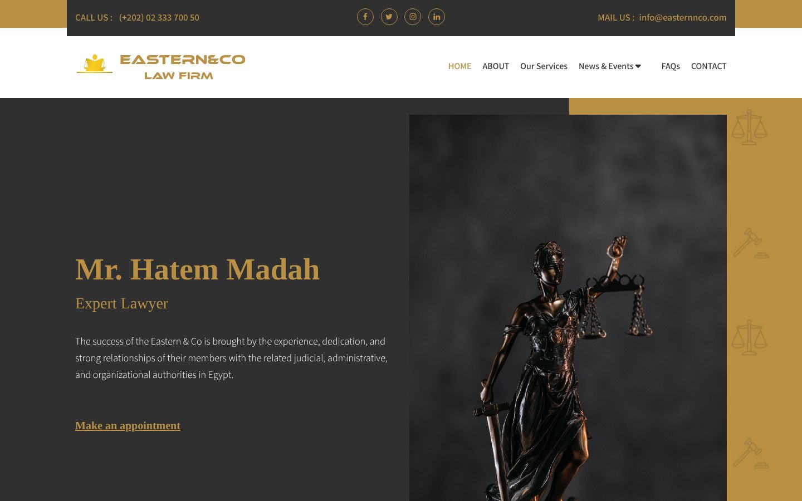
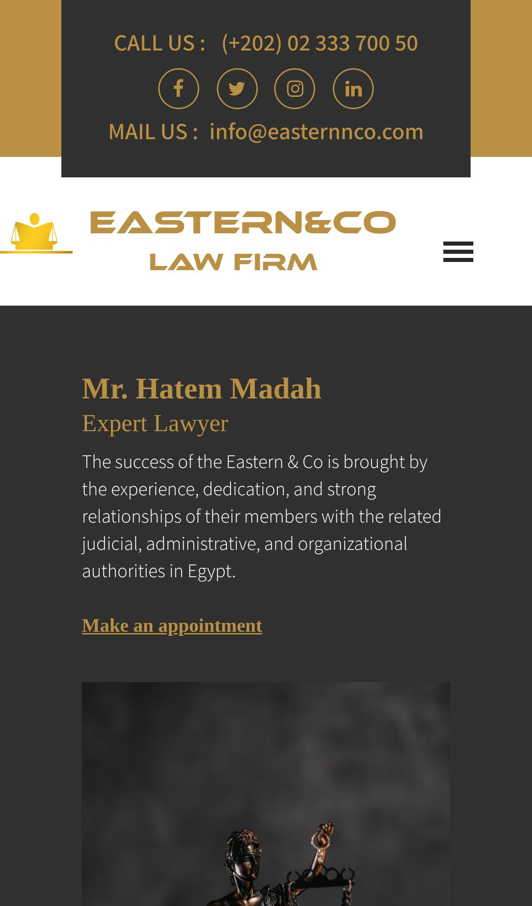
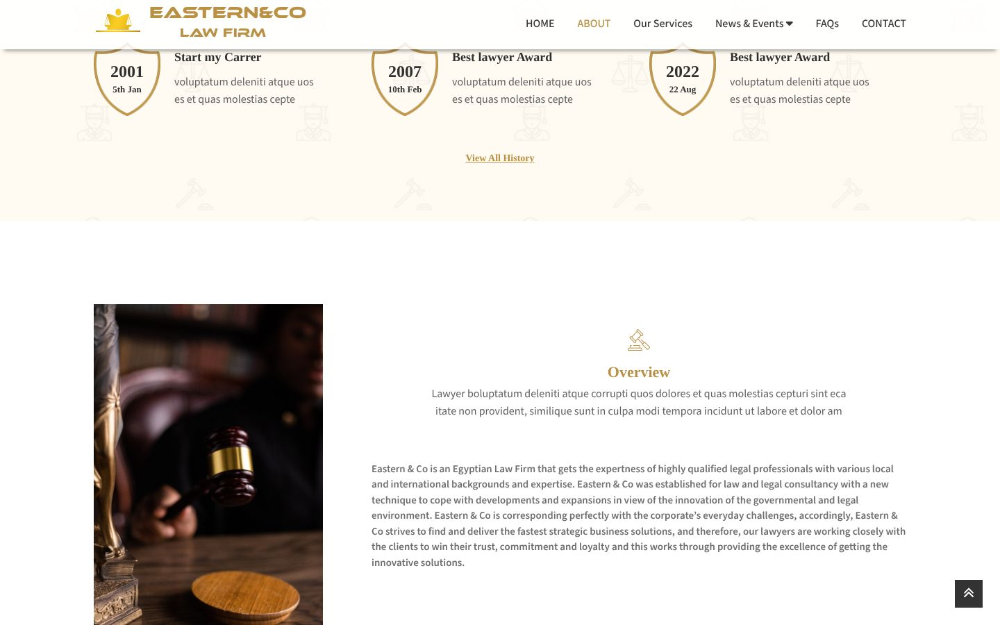

<div align="center">

# Eastern &amp; Co — Law Firm Website

### Multi-page law-firm website with services, news, events, FAQ and contact pages

A seven-page responsive site for **Eastern &amp; Co**, a law firm in Egypt. It is built on a Bootstrap 4 law-firm HTML template (Adalot) that I re-branded and filled with the firm's content.

[](https://developer.mozilla.org/docs/Web/HTML)
[](https://developer.mozilla.org/docs/Web/CSS)
[](https://developer.mozilla.org/docs/Web/JavaScript)
[](https://getbootstrap.com)
[](https://jquery.com)
<br>
[](https://eslamraafat1.github.io/Law/)

**[Live demo](https://eslamraafat1.github.io/Law/)** ·
**[Portfolio](https://new-portfolio-ashy-xi.vercel.app/)** ·
**[LinkedIn](https://www.linkedin.com/in/eslamraafat-dev/)** ·
**[Email](mailto:eslamraafat736@gmail.com)**

<br>



</div>

<table>
  <tr>
    <td width="33%"></td>
    <td width="67%"></td>
  </tr>
  <tr>
    <td align="center"><sub>Mobile (iPhone 13)</sub></td>
    <td align="center"><sub>About page: timeline and firm overview</sub></td>
  </tr>
</table>

---

## Contents

- [Overview](#overview)
- [Features](#features)
- [Tech stack](#tech-stack)
- [Pages](#pages)
- [Project structure](#project-structure)
- [Getting started](#getting-started)
- [Deployment](#deployment)
- [Known limitations](#known-limitations)
- [Author](#author)

## Overview

A website for **Eastern &amp; Co**, presented as an Egyptian law firm: a hero introducing the lead lawyer, the firm's practice areas, its history, pricing and an appointment form.

The layout and plugins come from the **Adalot** responsive law HTML5 template (its documentation is kept in `Documentation/`). My work on it, done in 2023, was:

- Re-branding: a new logo, gold-and-charcoal colour scheme and the Ethnocentric display font for the wordmark.
- Replacing the content with the firm's copy, contact details and social links.
- New imagery and logo variants in `img/new/`, and an FAQ page written around Egyptian business law (due diligence, corporate and income taxes).
- Adjusting the navigation (Home, About, Our Services, News &amp; Events dropdown, FAQs, Contact).

## Features

- **Responsive layout** with Bootstrap 4 and a separate `css/responsive.css`; on small screens the menu collapses into a MeanMenu mobile menu.
- **Top bar** with phone number, email and Facebook / Twitter / Instagram / LinkedIn links.
- **Home page sections:** hero, features, about, timeline, services, fun-facts counters, team, testimonials and quote, latest blog posts and a brand carousel.
- **Animated counters** (Waypoints + Counter-Up) and **scroll-reveal animations** (WOW.js + Animate.css).
- **Carousels** for the team and the brand logos (Owl Carousel 2.2.1).
- **Video lightbox** (Venobox) that plays a YouTube video from the about section.
- **Cases grid** on the News page: image cards with practice-area labels.
- **FAQ page** with long-form answers on due diligence and Egyptian corporate, income and salary taxes.
- **Contact form** that posts to a PHP mailer (`mail.php`) with server-side validation. `appointment.php` is a second handler from the template that no page uses yet.
- **Scroll-to-top** button (scrollUp).

## Tech stack

| Layer | Tools |
| --- | --- |
| Markup | HTML5, 7 static pages |
| Styling | CSS3, Bootstrap 4.0.0, `style.css` + `css/responsive.css`, Animate.css, Font Awesome 4.7 / 6.4, IcoFont |
| Scripting | jQuery 1.12.4, Modernizr 2.8.3 |
| Plugins | Owl Carousel 2.2.1, MeanMenu, Waypoints + Counter-Up, WOW.js, Venobox, scrollUp (the template's datepicker and calendar plugins are also loaded) |
| Forms | PHP mail handler (`mail.php`) |
| Base template | Adalot — Responsive Law HTML5 Template |
| Hosting | GitHub Pages |

## Pages

| Page | File | What's on it |
| --- | --- | --- |
| Home | `index.html` | Hero, features, about, timeline, services, counters, team, testimonials, blog, brands |
| About | `about.html` | Firm overview, features, timeline, services, counters, testimonials |
| Our Services | `service.html` | Practice areas and counters |
| News (menu: News &amp; Events) | `appointment.html` | Grid of case cards with practice-area labels |
| Events (menu: News &amp; Events) | `history.html` | History / events page and call-to-action |
| FAQs | `pricing-plan.html` | FAQ on due diligence and Egyptian taxes, plus a question form |
| Contact | `contact.html` | Contact form (`mail.php`) and contact details |

## Project structure

```text
.
├── index.html · about.html · service.html · history.html
├── pricing-plan.html · appointment.html · contact.html
├── style.css              # main theme styles
├── css/                   # Bootstrap, plugins, responsive.css
├── js/                    # jQuery plugins + main.js (plugin initialisation)
├── fonts/                 # icon and web fonts
├── img/                   # template images; img/new/ holds the firm's photos
├── mail.php               # contact form handler
├── appointment.php        # appointment form handler (from the template, unused)
├── Documentation/         # the base template's documentation
├── file test/             # copy of the imagehover.css library used for testing
└── docs/screenshots/      # README images
```

## Getting started

```bash
git clone https://github.com/Eslamraafat1/Law.git
cd Law
npx serve .        # or open index.html in a browser
```

The contact form handler needs a PHP server with `mail()` configured, for example:

```bash
php -S localhost:8000
```

Before using them for real, set the recipient address in `mail.php` (it is still `info@example.com`).

## Deployment

The static pages are served by **GitHub Pages**: [eslamraafat1.github.io/Law](https://eslamraafat1.github.io/Law/). GitHub Pages does not run PHP, so the contact form does not send email on the live demo.

## Known limitations

- The photos in `img/new/` are uncompressed (several are 4–8 MB each), which makes the repository about 80 MB and slows down the first load.
- Some sections still contain the template's placeholder text (for example the timeline entries on the About page), and every case card on the News page carries the same labels.
- Some file names don't match their content (`appointment.html` is the News page, `pricing-plan.html` is the FAQ page).
- Links to `single-blog.html` and `single-service.html` point to pages that are not in the repository.
- The newsletter forms still post to the template author's Mailchimp list.

## Credits

Built on the **Adalot** law HTML5 template. The Eastern &amp; Co name, logo and content belong to Eastern &amp; Co. Code shared for portfolio purposes.

## Author

**Eslam Raafat** — Front-End Developer (React · Next.js · TypeScript)

- **Portfolio:** [new-portfolio-ashy-xi.vercel.app](https://new-portfolio-ashy-xi.vercel.app/)
- **LinkedIn:** [linkedin.com/in/eslamraafat-dev](https://www.linkedin.com/in/eslamraafat-dev/)
- **GitHub:** [@Eslamraafat1](https://github.com/Eslamraafat1)
- **Email:** [eslamraafat736@gmail.com](mailto:eslamraafat736@gmail.com)
